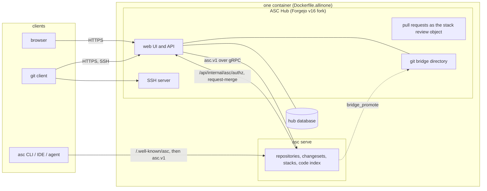

<div align="center">
    
    <h1>ASC Hub</h1>
    <p><strong>Source control for people and their agents.</strong></p>
</div>

ASC Hub is the hosting product for ASC (Agent Source Control): a web server where people review and land stacks of changesets that they made with the `asc` command line or an IDE plugin.
It is a fork of [Forgejo](https://forgejo.org) v16 that keeps Forgejo's web foundation (accounts, organizations, teams, issues, sign-in, administration, Actions) and replaces the repository layer: repositories are stored by `asc serve` and the hub talks to it over the `asc.v1` RPC protocol.
ASC Hub is **not Forgejo** and **not a git forge**. Git clients can still clone and push through a compatibility layer, but the repository of record is an ASC repository, not a bare git directory.

## Who it is for

People first. The web UI, the review flow, the inbox and the sign-in are built for developers and reviewers working in a browser, on a laptop or on a phone.
Agents are optional: a coding agent that drives `asc` works against the same hub, the same permissions and the same review rules as a person does. Nothing in the hub requires an agent.

## Why ASC Hub

We kept running into the same problems with branches and pull requests: long branches that are hard to review, stacked work that has to be rebased by hand, force-pushes that people are afraid of, approvals that go stale when the author pushes again, and agents that can make a dozen changes an hour. So ASC stores work as changesets in stacks, keeps every version of each change, and lets reviewers approve an exact version. We forked Forgejo instead of starting from zero because accounts, organizations, sign-in, issues and administration are already solved there, and we replace only the repository layer. We kept git compatibility so that nobody has to move all their tools on one day. [docs/asc/WHY.md](docs/asc/WHY.md) has the longer argument, what ASC Hub will not do, and the benefits with their status.

## Benefits

Each line names the mechanism. "Planned" means it is not built. [docs/asc/WHY.md](docs/asc/WHY.md#benefits) has the full tables.

- **Developers.** Undo with `asc undo` and `asc redo` (local operations; a push or land is not undone), restore an earlier version of a change from the web, small stacked changes with one review each, review from a phone (mobile-first pages). No speed claim: we have no measured numbers for the hub.
- **Teams.** Approvals tied to a version, with the diff between versions and "changes since your last review"; fewer approvals for docs-only style changes by rules that the change cannot edit; an ordered merge queue with a web button, a restack button and the revert of a landed stack. Planned: policy file in the repository, signed changes, failure and flaky-test grouping, an audit page.
- **People using agents.** Scoped access tokens, MCP tools in `asc` with writes enabled only by the user's configuration, pushes to non-shared names stored as the pusher's own refs in a branchless repository, everything reversible through kept versions, search by meaning on the repository search page. Planned: agent budgets.
- **Operators.** One container with the hub and `asc serve` inside (`Dockerfile.allinone`), SQLite or Postgres, a Coolify deployment, git clients keep working through the bridge. Bring your own S3 storage and bring your own AI keys have settings pages for a person, an organization and a repository (partial: they need an `asc serve` that implements them).

## Feature highlights

Status is what the code in this repository does today. Items marked "partial" are implemented in the hub but not yet reachable from every surface. Items marked "planned" do not exist in this repository.

| Area | Status | What there is |
| --- | --- | --- |
| Stacks | available | A stacked pull request is the review object of one `asc` change. The pull request page shows the stack panel, overlap and mergeability badges, and blocks a merge of a mid-stack change until its parent has merged. A stack compare page (`/<owner>/<repo>/asc/compare`) and a commit graph (`/<owner>/<repo>/asc/graph`) are routed. Landing a stack bottom to top through asc, and restacking the open children, is done by the merge queue below. A "Restack" button rebases the whole stack onto the target through asc and moves the pull request heads, keeping an approval where the patch is unchanged. |
| Reviews | available | Every version of a change is kept. The pull request page has a versions dropdown, the diff between any two versions, and "changes since your last review". Branch protection can relax the approval count for changes that only touch chosen change classes (docs, lockfiles, ...), and the file list shows a class badge. |
| Inbox and drafts | available | `/-/asc/inbox` sorts review work by whose turn it is, with per-user pin and snooze; `GET /api/v1/user/asc/inbox` and `/api/v1/user/asc/inbox/count` serve the same data. `/-/asc/drafts` lists your drafts. |
| Merge queue | available | An ordered queue lands the largest ready prefix of a stack, can be paused per branch, and re-checks permission at every land. The pull request page has "Merge when ready" and "Merge the stack up to here", each behind a confirmation page that runs a dry run first; the queue of a branch is at `/<owner>/<repo>/asc/queue`. `asc` can enter it through `POST /api/internal/asc/request-merge`. When the target moved so that a land would need a content merge, asc refuses it (`LAND_NEEDS_CONTENT_MERGE`); the stack is restacked through asc and waits for the checks and approvals of its new versions. Needs an asc server that advertises `stacks.v1`; without it the hub says so and changes nothing. See [Stack operations](docs/asc/STACK-OPERATIONS.md). |
| Undo | available | "Restore version" moves a stacked pull request back to an earlier version (`POST .../asc/restore_version`). "Revert" on a merged stacked pull request reverts that pull request or the whole landed stack, or makes one squashed revert, through asc: asc stores the reverts as new changes (the target branch is never written) and the hub opens a stacked pull request for each, so the revert is reviewed like any change. Needs `stacks.v1` on the asc server. See [Stack operations](docs/asc/STACK-OPERATIONS.md). |
| Code search | partial | `/<owner>/<repo>/asc/search` searches one repository in lexical, symbol and semantic modes, using asc's code index, after the hub's own code-read check for the signed-in user. The cross-repository search on the explore page, the symbol panel and the JSON search API exist as handlers but are not routed yet. |
| Policy and audit | partial | Path policy is decided in asc, and the hub shows its refusal to the pusher. Relaxed approvals by change class are enforced by the hub. Restoring a version writes an `asc audit:` line to the log. There is no audit page. |
| Actions | available | Workflow runs get `asc_server_url`, `asc_changeset`, `asc_base_merge_base`, `asc_change`, `asc_stack_position`, `asc_stack_size` and `asc_stack_parent_sha` in their context, and a job token honours `permissions:` ([docs/asc/actions-token-permissions.md](docs/asc/actions-token-permissions.md)). |
| IDE sign-in | available | A pre-registered OAuth2 public client, `asc-ide`, with PKCE (S256 only) for the ASC IDE plugins. |
| Mobile-first UI | available | The ASC themes (`asc-auto`, `asc-light`, `asc-dark`) and the landing, header, repository and sign-in pages are written mobile first, from 320 px up ([docs/asc/THEME.md](docs/asc/THEME.md)). |
| Bring your own S3 storage | partial | Settings pages for a person (`/user/settings/asc/storage`), an organization and a repository: add an S3-compatible target, verify it with a probe object, enable it, move the objects of a repository with progress, remove it. Credentials are write-only and never shown again. The pages need an `asc serve` that implements the Storage service (`storage.v1`), which `asc serve` does not do yet, so they are tested against a stand-in. See [docs/asc/STORAGE-AND-KEYS.md](docs/asc/STORAGE-AND-KEYS.md). Where `asc serve` keeps its objects without a target stays an operator setting. |
| Bring your own AI keys | partial | Settings pages for a person (`/user/settings/asc/ai`), an organization and a repository: add a provider key with an optional monthly cap, test it, see the models and this month's usage, disable or remove it. Keys are write-only and shown as their last four characters. The pages need an `asc serve` that implements the AiProviders service (`ai-keys.v1`), which `asc serve` does not do yet, so they are tested against a stand-in. See [docs/asc/STORAGE-AND-KEYS.md](docs/asc/STORAGE-AND-KEYS.md). |

## Quick start

One container runs everything: the hub and `asc serve` (the ASC backend) start together from a single image, `ghcr.io/<owner>/asc-hub`, built from `Dockerfile.allinone`. You need Docker with Compose, a DNS name for the hub (`hub.example.org` below) and a TLS-terminating reverse proxy in front of port 3000. The image is tagged with the 12-character commit id and with `asc-v16`; pin the commit id.

```yaml
# compose.yml: the hub and asc serve are both inside this one service
services:
  hub:
    image: ghcr.io/<owner>/asc-hub:<sha12>
    restart: unless-stopped
    stop_grace_period: 30s
    environment:
      ROOT_URL: "https://hub.example.org/"       # the public https address
      SSH_DOMAIN: "hub.example.org"
      SSH_PORT: "22223"                          # the host port below, shown in clone URLs
      ASC_HUB_ADMIN_EMAIL: "admin@example.org"   # creates the first administrator once
    volumes:
      - hub-data:/var/lib/gitea
    ports:
      - "3000:3000"      # web: put your TLS proxy in front of it
      - "22223:2222"     # git over SSH (the built-in server listens on 2222 in the container)

volumes:
  hub-data:
```

The entrypoint, the health check and the backup tool of the image are tested against fake programs (`tests/allinone`); the image itself is built by CI. After your first deployment run `scripts/smoke.sh`, which signs in, creates a repository, pushes and clones it over https and ssh, and deletes it again ([docs/asc/OPERATIONS.md](docs/asc/OPERATIONS.md#checks-after-a-deploy)). The volume must belong to uid 1000; backups and restores use `asc-hub-backup` ([docs/asc/OPERATIONS.md](docs/asc/OPERATIONS.md#backup-and-restore)).

On first start the container generates the secrets it shares with `asc serve`, writes the `asc serve` configuration, runs its migrations, starts the hub with `[asc] WRITER = asc` and `NEW_REPOSITORIES = asc` already set, then starts `asc serve` on `127.0.0.1:7890` inside the container. You edit no `[asc]` setting for this. [docs/asc/OPERATIONS.md](docs/asc/OPERATIONS.md) lists every variable, the volume layout and the other deployment shapes.

Start it with `docker compose up -d`. With `ASC_HUB_ADMIN_EMAIL` set, the container creates the administrator `asc-admin` once, after the hub is up, and writes the generated password to a file that only the container user can read:

```sh
docker compose exec hub cat /var/lib/gitea/bootstrap/admin-password
```

Sign in at `https://hub.example.org/`, set a new password (the account must change it), delete that file, and create a repository. With `NEW_REPOSITORIES = asc` it is stored in ASC. Without `ASC_HUB_ADMIN_EMAIL`, create the administrator by hand, once:

```sh
docker compose exec hub forgejo admin user create --admin   --username asc-admin --email admin@example.org   --random-password --must-change-password=true
```

On your machine, with the `asc` CLI installed:

```sh
# make a token in the hub: Settings > Applications > Generate New Token
printf '%s' "$TOKEN" | asc auth login --host https://hub.example.org --token-stdin
asc clone https://hub.example.org/<owner>/<repo>
```

`asc auth login` stores the token with your git credential helper, and `asc clone` reads `https://hub.example.org/.well-known/asc` to find the ASC server. A git client can still use `git clone https://hub.example.org/<owner>/<repo>.git` against the same repository; see [Git compatibility](#git-compatibility).

## Configuration

Settings are read from `app.ini` (`custom/conf/app.ini`, `/var/lib/gitea/custom/conf/app.ini` in the image). In the image, `environment-to-ini` also copies every `FORGEJO__<section>__<KEY>` environment variable into `app.ini` at start (the section name is case-insensitive, so `FORGEJO__asc__KEY` and `FORGEJO__ASC__KEY` are the same). The hub program reads no environment variable named `ASC_*` itself; the only `ASC_BINARY` is the `[asc]` key below, set as `FORGEJO__asc__ASC_BINARY`. In the all-in-one image the entrypoint script reads a few `ASC_*` and `ASC_HUB_*` variables to configure `asc serve` and sets defaults for every `[asc]` key below (it only fills in what you have not set); those variables are listed in [docs/asc/OPERATIONS.md](docs/asc/OPERATIONS.md).

The `[asc]` section (`modules/setting/asc.go`). Every key other than `ENABLED` is checked only when `ENABLED = true`, and an invalid value stops the start.

| Key | Environment variable | Default | Meaning |
| --- | --- | --- | --- |
| `ENABLED` | `FORGEJO__asc__ENABLED` | `false` | Turns on the ASC integration: the internal authz endpoint, `/.well-known/asc` and the asc client. Needs the internal token. |
| `SERVER_URL` | `FORGEJO__asc__SERVER_URL` | none, required | Where the hub dials `asc serve`. Absolute `http` or `https` URL without credentials, query or fragment. The client refuses plain `http` to a host that is not loopback. A bare `host:port` is not accepted here; the default asc port is 7890. |
| `PUBLIC_URL` | `FORGEJO__asc__PUBLIC_URL` | `SERVER_URL` | The address announced to asc clients by `/.well-known/asc` and to Actions runners. Must be `https` unless the host is loopback. |
| `WRITER` | `FORGEJO__asc__WRITER` | `git` | `asc` sends every write to an ASC repository through `asc.v1`. `git` keeps the older flow that pushes into the git bridge and lets asc import it. |
| `NEW_REPOSITORIES` | `FORGEJO__asc__NEW_REPOSITORIES` | `git` | Storage backend of a repository created from now on: `git` or `asc`. Takes effect only with `WRITER = asc`. Migrations and mirrors stay git. |
| `BRIDGE` | `FORGEJO__asc__BRIDGE` | `eager` | How the git directory that serves legacy git clients is kept: `eager` (asc keeps it current), `lazy` (the hub builds it with `asc export --git` on the first git request) or `off` (git access to ASC repositories is refused). |
| `ASC_BINARY` | `FORGEJO__asc__ASC_BINARY` | `asc` | The `asc` executable a `lazy` bridge runs. The all-in-one image has it at `/usr/local/bin/asc`. |
| `BRIDGE_WORKSPACES` | `FORGEJO__asc__BRIDGE_WORKSPACES` | `<APP_DATA_PATH>/asc-bridge` | Directory of the asc workspaces a `lazy` bridge is built from. |
| `SHADOW_SAMPLE_PERCENT` | `FORGEJO__asc__SHADOW_SAMPLE_PERCENT` | `10` | For repositories with storage backend `dual`: the share (0 to 100) of reads repeated against asc and compared. `0` turns it off. |

Related settings:

| Setting | Environment variable | Meaning |
| --- | --- | --- |
| `[security] INTERNAL_TOKEN` or `INTERNAL_TOKEN_URI` | `FORGEJO__security__INTERNAL_TOKEN_URI` | The secret shared with `asc serve`. Required when `[asc] ENABLED` is true. Use the `file://` form so the token stays out of `app.ini`. |
| `[asc_stack_queue] REVALIDATE` | `FORGEJO__asc_stack_queue__REVALIDATE` | `on_content_merge` (default; any value but `off` means this) or `off`. See [Merge queue](#feature-highlights). |
| `[ui] DEFAULT_THEME` | `FORGEJO__ui__DEFAULT_THEME` | `asc-auto` by default. |
| `APP_NAME` | `FORGEJO____APP_NAME` (four underscores for a key outside a section) | `ASC Hub` by default in the code. The container's first-start template writes `Forgejo: Beyond coding. We forge.` unless you set the plain `APP_NAME` variable, as the example above does. |

## Git compatibility

An ASC repository can be cloned and pushed to with `git` over HTTPS and SSH. The hub keeps a git directory per repository, the bridge, at the path Forgejo always used, and serves git requests from it. A git push is imported into ASC by the pre-receive hook before it is accepted; a refusal from asc is returned to the pusher. Limits: ASC repositories have no LFS (the LFS routes answer 404), and a git signing decision cannot be honoured by the asc writer. Details are in [docs/asc/ARCHITECTURE.md](docs/asc/ARCHITECTURE.md).

## Architecture



[docs/asc/ARCHITECTURE.md](docs/asc/ARCHITECTURE.md) explains each box and names the packages.

## Documentation

- [docs/asc/WHY.md](docs/asc/WHY.md): why ASC Hub exists, why a fork, what it will not do, the benefits.
- [docs/asc/ARCHITECTURE.md](docs/asc/ARCHITECTURE.md): components, data ownership, request flows, trust.
- [docs/asc/OPERATIONS.md](docs/asc/OPERATIONS.md): deploy, volumes, ports, backup and restore, upgrade, SQLite and Postgres.
- [docs/asc/FORK.md](docs/asc/FORK.md): how the fork differs from Forgejo and how upstream is merged.
- [docs/asc/BRANDING.md](docs/asc/BRANDING.md), [docs/asc/THEME.md](docs/asc/THEME.md): brand assets and themes.
- [docs/asc/README.md](docs/asc/README.md): index of the remaining notes.

## Development

Requirements: Go 1.26 (`go.mod` pins the toolchain), Node.js 20 or newer, `make`, and a C compiler for the SQLite build. The tests need Linux; on Windows use WSL or CI.

```sh
make deps            # frontend, backend and tool dependencies
make build           # frontend and backend; produces ./gitea
make watch           # rebuild on change while developing
go build -tags 'sqlite sqlite_unlock_notify' ./...
make test-backend    # unit tests
make test-sqlite     # integration tests on SQLite
make lint
```

The CI for this fork is in `.github/workflows/asc-hub-test.yml` (build, vet and test the ASC packages) and `.github/workflows/asc-hub-image.yml` (the all-in-one image; it needs the repository variable `ASC_SERVE_IMAGE`, see the comments in the file). To build the image yourself: `docker build -f Dockerfile.allinone --build-arg ASC_IMAGE=ghcr.io/<owner>/asc-serve:<tag> -t asc-hub .`. The generated Go stubs for `asc.v1` are committed under `modules/ascproto`; [modules/ascproto/README.md](modules/ascproto/README.md) says how to regenerate them.

## Security

Report a vulnerability in the ASC-specific code (the packages listed in [docs/asc/ARCHITECTURE.md](docs/asc/ARCHITECTURE.md)) privately through [GitHub private vulnerability reporting](https://github.com/Jordan-Hall/asc-hub/security/advisories/new) for this repository, not in a public issue. A vulnerability in code that comes unchanged from Forgejo should also go to the Forgejo project, as described in [CONTRIBUTING.md](CONTRIBUTING.md) (`security@forgejo.org`). The hub's internal API accepts only the shared internal token, `[asc] PUBLIC_URL` must be `https` unless its host is loopback, and the authz endpoint answers a denied repository the same way as a missing one.

## Fork and attribution

ASC Hub is a fork of [Forgejo](https://forgejo.org), the community-owned software forge, which is itself a continuation of Gitea. The fork is based on the Forgejo **v16.0.6** release (commit `1aa13944143b3bc4312607239a68da23512d5ce3`, "2026-10-12 security patches", on the `v16.0/forgejo` branch) and lives on the `asc/v16` branch as a stack of changes on top of that release. Upstream releases and security fixes are merged into `asc/v16`; [docs/asc/FORK.md](docs/asc/FORK.md) describes the procedure and lists exactly what differs.

What ASC Hub changes: the repository layer (storage, writes, merges, pull request heads, search), the review model for stacks, the branding and the theme. What it keeps: Forgejo's accounts, organizations, teams, issues, authentication, administration, package registry and Actions, plus the internal names (Go module path `forgejo.org`, the `forgejo` binary, `FORGEJO__` environment variables), so that upstream changes still apply.

ASC Hub is not an official Forgejo release. The footer keeps a "Based on Forgejo" link and the licenses page, as the attribution.

## Licence

ASC Hub is distributed under the terms of the [GNU General Public License, version 3](LICENSE) or any later version, like Forgejo since its v9.0. Forgejo versions before v9.0 were distributed under the MIT license. All upstream copyright notices and SPDX headers stay in the files; files that Forgejo took from Gitea keep their MIT headers; files added by this fork carry their own header with the same SPDX tag convention. The licenses of third-party dependencies are listed at `/assets/licenses.txt` on a running hub.
