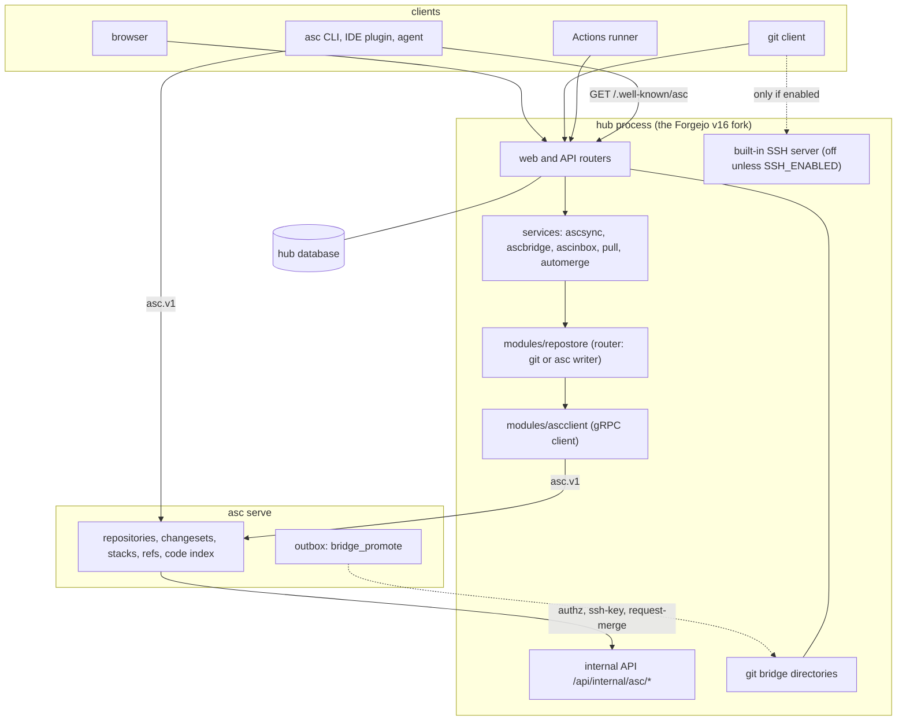

# ASC Hub architecture

ASC Hub is a fork of Forgejo v16 (see [FORK.md](FORK.md)). Forgejo's web application still runs the accounts, organizations, teams, issues, sign-in, administration, Actions and package registry. The repository layer is different: a repository can be stored in `asc serve` (storage backend `asc`), and the hub reads and writes it through the `asc.v1` RPC protocol. This page says what runs where, who owns which data, and which packages hold the code. Every path named here exists in this repository.

## Deployment unit

The product ships as one container image (`Dockerfile.allinone`). Inside it, `asc-hub-entrypoint` (under `dumb-init`) generates the secrets the two programs share, writes the `asc serve` configuration, runs `asc serve migrate`, starts the hub, waits for `GET /api/healthz`, starts `asc serve` on `127.0.0.1:7890`, and then supervises both with `wait -n`: if either exits, it stops the other and exits non-zero. The `asc` binary is copied from the published `asc-serve` image. The two programs share a user, a volume (`/var/lib/gitea`) and the loopback interface; they keep separate environments. [OPERATIONS.md](OPERATIONS.md) has the details. The boxes below are logical: in the all-in-one image they are two processes of one container, and in the hub-only image (`Dockerfile.rootless`) `asc serve` runs as a separate service.

## Components

| Part | Owns |
| --- | --- |
| Hub (this repository) | Users, organizations, teams, permissions, issues, pull request metadata (reviews, comments, status checks, merge queue entries), sessions, OAuth applications, access tokens, Actions runs, packages, the git bridge directories, and every web page. |
| `asc serve` | The repositories themselves: objects, refs, changesets, stacks and their versions, branchless settings, path policy, and the code index. |
| The `asc` client | Makes changesets and stacks, talks to `asc serve` after discovering it through the hub. |

The hub keeps no second copy of what asc owns. For example the branchless settings of a repository are read from asc and shown, never written, by the hub (`services/ascsync/branchless.go`, page `/<owner>/<repo>/settings/asc/branchless`), and the link between a pull request and its asc change is the only change data the hub stores (`models/issues/pull_asc_stack.go`).

## Review objects: pull requests that wrap changes

The hub did not remove Forgejo's pull request machinery. A stacked pull request is the pull request of one `asc` change: the table `pull_asc_stack` (migration `models/forgejo_migrations/v17e_asc_stack.go`) links a pull request to the 32-letter change id and to the pull request of the parent change. Review, comments, approvals and checks live on that pull request; the versions of the change, and the stack order, are asc's (`Changes.Versions`, `Changes.Stack`). Pages that are shared with git-stored repositories still use the word "pull request". [ASC-NATIVE-UI.md](ASC-NATIVE-UI.md) lists the pages that say "asc" and the ones that were left alone on purpose.

## Storage backends

Each repository row has a `storage_backend` (migration `v17b_asc_storage_backend.go`): `git`, `dual` or `asc` (`modules/gitrepo/backend_select.go`).

- `git`: the bare git directory is the repository, as in Forgejo. Every existing repository is `git`.
- `dual`: served from git, with a sample of reads repeated against asc and compared (`[asc] SHADOW_SAMPLE_PERCENT`, `modules/git/dual`).
- `asc`: asc is the truth. Reads go to `modules/git/ascbackend`, writes to `modules/repostore/asc`.

`[asc] NEW_REPOSITORIES` chooses the backend of repositories created from now on, and only takes effect with `[asc] WRITER = asc`. Import, migration and mirror creation still produce `git` repositories.

## Request flows

### Writes through the web UI

A web edit, a merge, or a pull request head update calls `modules/repostore`. The router (`modules/repostore/route.go`) picks the writer by the repository's storage backend, and a request that spans an asc repository and another backend is refused. The asc writer (`modules/repostore/asc`) turns the request into one RPC sequence: git ids are mapped at the boundary, a change is built without a ref and published with a single `UpdateRefs` call (fast-forward, or forced when asked), and `refs/pull/*` updates use `HOOK_MODE_SKIP_PRE`. The writer fails closed: an asc repository is never written by the git writer, whatever is down. Limits: a request that asks for a signed commit fails (`asc serve` has no signing key), and the file content of one commit is limited to 15 MiB.

### Reads

`modules/git/ascbackend` implements the hub's git backend interface on top of `asc.v1`, with verified object fetches and a bounded cache (`modules/ascclient`). Pages that need only git facts keep working on any backend.

### git push (the optional compatibility layer)

A push arrives at the hub over HTTPS (the git-compatible endpoint, `https://<hub>/<owner>/<repo>.git`, with an access token as the password) or, when the operator enabled `[asc] SSH_ENABLED`, over SSH. The default is HTTPS only: an ASC Hub needs no inbound port besides 443, and with `SSH_ENABLED = false` the hub forces `[server] DISABLE_SSH = true`, so there is no SSH server, no SSH keys page and no SSH clone address. The pre-receive hook (`services/ascsync/importpush.go`) hands the push quarantine to asc with `ImportGitPush`; asc imports the commits and moves its refs in fast-forward mode. A refusal from asc (a rejected ref, a path policy, a stale old value) is returned to the pusher with the control characters removed and at most 512 bytes. Any other failure rejects the push with a fixed text. `refs/for/*` commands are never forwarded. The named limits (import 55 s, call 30 s, bridge wait 30 s, at most 1024 ref updates) are in `services/ascsync/ascsync.go`; [asc-stage2-hooks.md](asc-stage2-hooks.md) has the rest.

### git clone and fetch (the optional bridge)

`services/ascbridge` keeps one git directory per asc repository, at the path Forgejo always used, because legacy consumers (git over HTTPS, and SSH when enabled; checkout in Actions, push mirrors, submodules) need a git directory. `[asc] BRIDGE` says how it is kept:

- `eager` (default): asc's outbox keeps the directory current (`bridge_promote`); the hub makes sure it exists.
- `lazy`: the hub builds it on the first git request with `asc export --git` (the `asc` binary at `[asc] ASC_BINARY`, in workspaces below `[asc] BRIDGE_WORKSPACES`) and rebuilds when a fingerprint of asc's refs changes. The child process gets a minimal environment with the internal token as `ASC_TOKEN`.
- `off`: git access to asc repositories is refused.

Nothing in the hub writes a ref into a bridge directory.

### Discovery and sign-in for asc clients

`GET /.well-known/asc` (`routers/web/wellknown_asc.go`) returns `{"server": <PUBLIC_URL or SERVER_URL>, "repos": "*"}`, is public and cacheable for 5 minutes, and answers 404 unless `[asc] ENABLED`. The client then talks to `asc serve` directly. `asc serve` asks the hub whether a credential may use a repository (`POST /api/internal/asc/authz`): bearer access tokens, OAuth2 tokens and Actions task tokens are accepted, and an HTTP Basic user and token pair is accepted for git-style clients. A refusal for a missing repository, an unreadable one and a missing permission look the same. SSH keys that `asc serve` has verified are looked up with `POST /api/internal/asc/ssh-key`. IDE plugins sign in with the OAuth2 public client `asc-ide` (`routers/web/auth/oauth_asc_ide.go`).

### Merge queue

`asc serve` calls `POST /api/internal/asc/request-merge` when a client asks to merge a change. The hub decides what the authenticated user may do and enqueues the stack (`services/automerge/asc_stack_queue.go`, tables `asc_stack_queue` and `asc_stack_queue_branch`, migration `v17h_asc_queue.go`). A poller (started on the first enqueue) lands the largest ready prefix through `pull_service.MergeAscStack`, checks the enqueuing user's right again at every land, and lets a repository or site administrator pause a branch. `[asc_stack_queue] REVALIDATE` controls the content-merge check; the default lander refuses to land when that check is on and the backend cannot carry the flag.

### Inbox, search, graph, compare

`services/ascinbox` computes whose turn each review is, with per-user pin and snooze (`models/issues/asc_inbox_state.go`, migration `v17g_asc_inbox_state.go`); the page is `/-/asc/inbox` and the API is `/api/v1/user/asc/inbox`. Repository pages `asc/search`, `asc/graph` and `asc/compare` read asc through `modules/ascclient`. A read-only RPC proxy for the web UI is `POST /-/asc/rpc/{service}/{method}`.

### Actions

`services/actions/asc_context.go` and `asc_stack_context.go` add `asc_server_url`, `asc_changeset`, `asc_base_merge_base`, `asc_change`, `asc_stack_position`, `asc_stack_size` and `asc_stack_parent_sha` to the workflow context. Job token permissions are in [actions-token-permissions.md](actions-token-permissions.md).

## Trust and failure rules

- The hub and `asc serve` share one secret, the internal token (`[security] INTERNAL_TOKEN` or `INTERNAL_TOKEN_URI`). `[asc] ENABLED = true` without it stops the start. The hub's internal API checks it in constant time.
- User-initiated calls forward the user's own token, so asc authorizes them as that user. A call that carries no user token must be marked as a system call explicitly; the client never falls back to the internal token on its own (`modules/ascclient/auth.go`).
- The signed-in person is also forwarded in a signed form, next to the token (`services/ascidentity`). See "Forwarded identity" below.
- `asc serve` authorises a repository by name through `POST /api/internal/asc/authz`. The endpoint answers only for a repository that the hub stores in asc (`storage_backend = asc`); a git repository that took over a name looks the same as a missing one. A rename or transfer of a repository, and the rename of a user or an organisation, first move every asc repository of that owner in the asc registry (`RepoAdmin.rename`, `services/repository/asc_rename.go`) and stop with an error when asc cannot be told; a later failure moves the registry back. An allowed answer carries `repo_id` and `owner_id`, the stable hub ids, so that `asc serve` can bind its registry entry to `repo_id` and refuse an entry whose id differs.
- The token of a call made for a person lives for one request and has the least scope asc accepts (`services/asctrust/usercall.go`, `scopeOf`): `read:repository` and `read:user` for a read, and `write:repository` only for the changes and the administrator-only calls, because asc decides "administrator" by asking the hub for write access and reading the permission in the answer. A token for a repository is limited to that repository by a row; the token for the log of an organisation lists the organisation's asc repositories one by one (at most 200). No call token is ever for all repositories of a person. An asc that asked for read access and read the permission from the answer would let the hub drop `write:repository` from these.
- The hub dials `asc serve` over gRPC. Plain `http` is accepted only for a loopback host; that is why the all-in-one image runs both on loopback in one container (see [OPERATIONS.md](OPERATIONS.md)), and a two-service deployment shares one network namespace. `[asc] PUBLIC_URL` must be `https` unless loopback, because clients send credentials there.
- Mutating calls carry an operation id that is reused across retries, so a retry is not a second write.
- Errors from asc reach users only as a named refusal; other failures become fixed texts.
- ASC repositories have no LFS: the LFS routes answer 404 (`services/lfs/asc.go`).

## Forwarded identity

A call made for a person carries that person's own token, and `asc serve` authorises it by that token. The hub adds the identity it signed in, so that `asc serve` can tell a site administrator from a writer and name the person in the audit log without a second lookup. `services/ascidentity` signs it; `asctrust.UserCall` and `ascagentui.UserCall` attach it to every call they make for a person. System calls carry no identity.

The contract is five gRPC metadata entries (HTTP/2 headers, lower case):

| Header | Value |
| --- | --- |
| `x-asc-hub-user` | The numeric user id on the hub, in decimal with no leading zero. |
| `x-asc-hub-login` | The login name: visible ASCII, no space, at most 255 bytes. |
| `x-asc-hub-admin` | `1` for a site administrator, `0` otherwise. |
| `x-asc-hub-ts` | The time of signing, Unix seconds, decimal. |
| `x-asc-hub-sig` | Lower-case hex of HMAC-SHA256 (64 characters) over the text below. |

The signing text is the five lines `asc-hub-identity-v1`, user, login, admin and ts, each ended by a line feed (`
`). The key is `HMAC-SHA256(secret, "asc-hub-identity-v1 key")`, where `secret` is the internal token that the hub and `asc serve` already share (`[security] INTERNAL_TOKEN` or `INTERNAL_TOKEN_URI`, at least 16 bytes). The bearer value is not used as the key itself.

A verifier must:

1. Refuse the identity when any of the five entries is missing or repeated.
2. Compute the signature over the received user, login, admin and ts, and compare it in constant time. Any mismatch is a refusal; the entries are not read as an identity before that.
3. Accept only the canonical decimal spelling of user and ts, `0` or `1` for admin, and a login of visible ASCII.
4. Refuse a time more than 5 minutes (`ascidentity.MaxSkew`) from its own clock, in either direction.
5. Treat the result as who the hub signed in, never as a grant: the call is still authorised by its token, and a call without a valid identity is an ordinary token call. An entry of this contract on a call that is not authenticated by the secret holder must be dropped, not trusted.

The hub replaces any `x-asc-hub-*` entry that a context already holds, so a caller cannot choose another person. A hub whose internal token is shorter than 16 bytes fails the call instead of signing with a weak key. `ascidentity.Verify` is the reference implementation of steps 1 to 4, and the tests pin its behaviour.

## Package map

| Path | Role |
| --- | --- |
| `modules/setting/asc.go` | The `[asc]` settings and their validation. |
| `modules/ascproto/ascv1` | Generated `asc.v1` stubs (see `modules/ascproto/README.md`). |
| `services/ascdownloadsync` | Fetches the signed `asc` release from a private source into `[asc] DOWNLOAD_DIR`: checks the checksums and files against the configured release public key, publishes atomically, keeps the last good release. |
| `services/ascidentity` | The signed identity of the person, forwarded with each call made for them. |
| `modules/ascclient` | The gRPC client: authentication, retries, operation ids, verified object fetches, cache. |
| `modules/repostore`, `modules/repostore/asc`, `modules/repostore/gitcli` | The writer interface, its router, and the asc and git writers. |
| `modules/git/ascbackend` | Reads of an asc repository as a git backend. |
| `modules/gitrepo/backend_select.go` | The storage backend values. |
| `modules/indexer/code/asc` | The code indexer backend that calls asc's code index. |
| `services/ascsync` | Push import, `refs/pull/*` heads, review state, branchless settings. |
| `services/ascbridge` | The git bridge directories. |
| `services/ascinbox` | The inbox. |
| `services/pull/*asc*.go`, `services/automerge/asc_stack_queue.go` | Stacks, versions and interdiff, restore, revert, merge, queue. |
| `services/agit`, `services/lfs/asc.go`, `services/repository/check_asc.go` | AGit push handling, the LFS refusal, the repository doctor check. |
| `routers/private/asc*.go`, `modules/private/asc.go` | The internal endpoints and their client. |
| `routers/web/wellknown_asc.go`, `routers/web/repo/asc_*.go`, `routers/web/user/asc_*.go` | Web pages and the discovery document. |
| `routers/api/v1/user/asc_inbox.go` | The inbox API. |
| `models/issues/pull_asc_stack.go`, `models/forgejo_migrations/v17*` | The tables added by the fork. |

## Known gaps

Not built: migrations and mirrors into asc, wiki pull mirrors, and the web LFS settings pages (see [asc-stage4-writer.md](asc-stage4-writer.md)).
